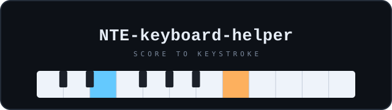
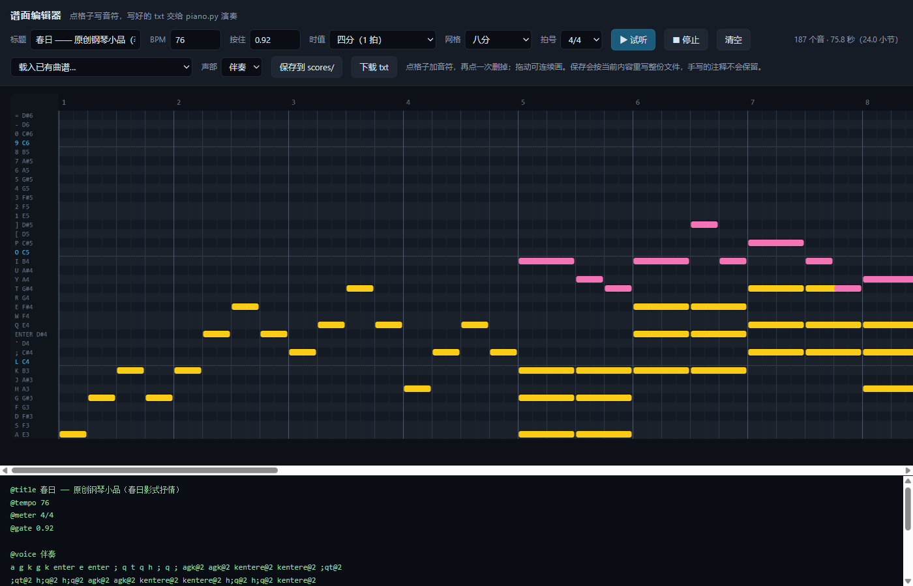

<div align="center">



**把电脑键盘当钢琴：读一份曲谱，按拍子自动敲出对应的键。**

它自己不发声 —— 对着网页钢琴、DAW、游戏这类「按下键盘就出声」的窗口用。
曲谱可以手写 txt、从 MuseScore 导入，或者在浏览器里点格子画出来。

[](https://www.python.org/)
[](LICENSE)
[](#安装)

[快速开始](#快速开始) · [曲谱格式](#曲谱格式) · [从 MuseScore 导入](#从-musescore-导入) · [可视化编辑器](#可视化编辑器) · [命令行](#命令行) · [许可证](#许可证)



<sub>浏览器里的谱面编辑器：金色是伴奏、粉色是旋律，底部实时生成 txt。</sub>

</div>

## 安装

```bash
git clone https://github.com/<your-name>/NTE-keyboard-helper.git
cd NTE-keyboard-helper
python piano.py --keys
```

Python 3.9 及以上。**Windows 上零依赖**，只用标准库；macOS / Linux 需要
`pip install pynput` 才能发按键。

<details>
<summary><b>Windows 上为什么一个包都不用装</b></summary>

按键走 `ctypes` 调 `user32.SendInput`，`INPUT` 结构体按 Win32 的 40 字节
（x64）严格对齐；时间轴用 `winmm.timeBeginPeriod(1)` 把系统计时精度从约
15ms 提到 1ms，再用 `perf_counter` 对齐。没有第三方依赖，也不装驱动。

</details>

## 快速开始

1. **先自检**，确认按键这条链路是通的：

   ```bash
   python piano.py --self-test
   ```

   它会在 5 秒倒计时后敲出 `a s d f`。把光标放到记事本或浏览器地址栏，
   看到这四个字符就说明没问题。

2. **切到目标窗口**，在倒计时里点一下网页钢琴 / DAW / 游戏，然后运行：

   ```bash
   python piano.py scores/twinkle.txt
   ```

3. **随时中止**：默认是全局 `Esc`，焦点在哪个窗口都有效。

不想真的按键时，用 `--print` 只看演奏计划：

```bash
python piano.py scores/canon.txt --print
```

## 它做什么

### 键位

三行各 12 个键，纯半音阶，行首都是 E，行与行正好差一个八度。

| 行 | 键位 | 音域 |
| --- | --- | --- |
| 数字行 | `1 2 3 4 5 6 7 8 9 0 - =` | E5 → D#6 |
| Q 行 | `Q W E R T Y U I O P [ ]` | E4 → D#5 |
| A 行 | `A S D F G H J K L ; ' Enter` | E3 → D#4 |

注意是逐键半音递增，不是白键黑键那种交错排布：

```
1=E5  2=F5  3=F#5  4=G5  5=G#5  6=A5  7=A#5  8=B5  9=C6  0=C#6  -=D6  ==D#6
q=E4  w=F4  e=F#4  r=G4  t=G#4  y=A4  u=A#4  i=B4  o=C5  p=C#5  [=D5  ]=D#5
a=E3  s=F3  d=F#3  f=G3  g=G#3  h=A3  j=A#3  k=B3  l=C4  ;=C#4  '=D4  Enter=D#4
```

C 大调音阶：`l ' q w r y i o`。

### 曲谱格式

txt 格式：一个 token 就是一个音或一个和弦，用空格分开，按顺序一拍接一拍。

| 写法 | 含义 |
| --- | --- |
| `q` | 敲一下，按住 1 拍（四分音符） |
| `lqr` | 并排写 = 和弦，三个键同时按下 |
| `q@8` | 八分音符；`@4` 四分、`@2` 二分、`@1` 全音符 |
| `q@8.` | 附点八分（0.75 拍）；`@4..` 是双附点 |
| `q@8T` | 三连音八分（1/3 拍）；`@4T` 三连音四分 |
| `q*1.5` | 直接写拍数，可以是小数 |
| `_` / `_@2` | 休止符，同样能带时值 |
| `\|` | 小节线，配合 `@meter` 会检查这一小节够不够长 |
| `#` | 注释 |
| `Enter` | 回车键 = D#4，写进和弦就是 `qEnter` |

> `[` `]` 是琴键（D5 / D#5），所以和弦只能用并排写或 `{}`，不能用方括号。

指令行以 `@` 开头，可以写在任意位置：

| 指令 | 说明 |
| --- | --- |
| `@title 名字` | 曲名 |
| `@tempo 120` | 速度（BPM，四分音符 = 1 拍），写在曲中即变速 |
| `@meter 3/8` | 拍号，用于小节线检查 |
| `@gate 0.9` | 按键按住比例，默认 0.9；调小 = 更断奏 |
| `@transpose 2` | 之后音符整体升降半音 |
| `@voice 伴奏` | 切换声部，每个声部有自己的时间轴 |

内部时间用 tick（`PPQ = 480`，和 MIDI 一致），所以附点、三连音都是整数，
连着写几十小节也不会累积浮点误差。

```text
@title 例子
@tempo 120
@meter 4/4

@voice 旋律
q@4. t@8 i@2 |
q@4 t@4 i@4 y@4

@voice 和声
afl@1 ahl@1
```

### 从 MuseScore 导入

在 MuseScore 里 **文件 → 导出**，选 **MusicXML** 或 **MIDI**，然后直接跑：

```bash
python piano.py 我的谱.musicxml --print
python piano.py 我的谱.mid -t 90
```

支持 `.musicxml` / `.xml` / `.mxl`（压缩包）/ `.mid` / `.midi`。
`.mscz` 是压缩工程文件，读不了，程序会提示你改用上面两种。

真正的难题是音域：键盘只有 36 个音（E3~D#6），钢琴谱通常跨五六个八度。
导入时程序会先算一个最优的八度平移，再处理剩下的：

```text
· 导入 812 个音，保留 764 个
· 整体升了 2 个八度才塞进音域
· 丢弃 48 个超出音域的音（想保留可试 --fit fold）
· 最多同时按 5 个键
```

### 可视化编辑器

```bash
python webui.py            # 起服务并打开浏览器，默认 http://127.0.0.1:8765
python webui.py --port 9000 --no-open
```

左边竖着 36 行键盘，横轴是拍子。点格子加音符、再点一次删掉、按住拖动连画；
顶部选时值（含附点和三连音）、网格（可切到三连音八分）和拍号；
**试听** 用浏览器自带的 WebAudio 合成；底部实时生成 txt。

解析和「音符 → txt」都在 Python 侧完成，浏览器只负责画界面，
所以不会出现两套格式互相打架。

## 命令行

```
python piano.py <曲谱> [选项]

  -p, --print        只打印演奏计划，不按键
  -c, --countdown N  开始前倒计时，默认 3 秒（0 = 立刻开始）
  -g, --gate 0.9     按键按住比例 0.05~1
  -t, --tempo BPM    整体变速
  -T, --transpose N  整体升降 N 个半音
  -m, --method M     按键注入方式：vk（默认）/ scan / pynput
      --fit M        导入时的音域处理：auto / none / fold
      --max-notes N  同一时刻最多保留 N 个音
      --stop-key K   全局中止热键，默认 esc
      --json         输出 JSON，给编辑器或其它程序用
      --self-test    敲 a s d f 自检
      --keys         打印键位表
```

| 入口 | 作用 |
| --- | --- |
| `python piano.py <曲谱>` | 倒计时后演奏 |
| `python piano.py <曲谱> --print` | 只看演奏计划 |
| `python piano.py <曲谱> --json` | 输出 JSON |
| `python piano.py --self-test` | 自检按键链路 |
| `python piano.py --keys` | 打印键位表 |
| `python webui.py` | 浏览器谱面编辑器 |
| `python -m unittest discover -s tests` | 跑测试 |

## 注意事项

1. **先自检** —— `python piano.py --self-test`，能敲出 `a s d f` 再往下走。
2. **倒计时内切到目标窗口** —— 按键发给当前焦点窗口。
3. **关掉中文输入法** —— 输入法激活时字母键会被吞，网页钢琴收不到 keydown。
4. **管理员权限** —— 目标程序以管理员身份运行时，本程序也要提权，否则被 UIPI 拦掉。
5. **键盘布局** —— 默认按标准 US 布局映射 `- = [ ] ; '`；不对时用 `--method scan` 改按物理扫描码。

## 实现

- **时序**：`timeBeginPeriod(1)` + `perf_counter` 对齐，最后 3ms 自旋，抖动在毫秒级。
- **每个音展开成两条动作**（按下 / 松开），按时间排序统一执行，多声部叠长音不会互相打断。
- **先松后按 + 配对编号**：每次按下带 `serial`，松开时只松自己那一次。
- **gate**：默认只按 90% 时值，留缝让重复音能再触发；最短 20ms。
- **退出兜底**：正常结束、中止、异常，`finally` 都会松开所有按下的键。
- **注入**：Windows 用 `SendInput`（结构体与 Win32 的 40 字节 `INPUT` 严格对齐），其它平台用 `pynput`。
- **导入**：MusicXML 走 `ElementTree`（divisions / backup / 和弦 / 连音线 / 拍号 / 速度记号），
  MIDI 走手写的字节解析（变长整数、running status、tempo 与拍号 meta）。
- **导出**：`dump_txt` 按声部保留结构；标准时值写成 `@8.`，零头拆成几个标准休止符凑出来。

## 曲谱

`scores/` 里的示例：

| 文件 | 说明 |
| --- | --- |
| `twinkle.txt` | 小星星，单声部入门 |
| `ode_to_joy.txt` | 欢乐颂，附点节奏 |
| `canon.txt` | 卡农和弦进行，双声部 + 和弦 |
| `three_eight.txt` | 3/8 小步舞曲 |
| `rhythm_demo.txt` | 附点与三连音 |
| `syntax_demo.txt` | 把全部记谱语法过一遍 |
| `happy_birthday.csv` | csv 格式示例 |
| `spring.txt` | 原创抒情小品，双声部 |
| `haruhikage*.txt` | 个人扒的谱，仅作练习 |

> [!NOTE]
> 除 `haruhikage*.txt` 外，`scores/` 里的内容随本项目的 MIT 许可一起授权。
> `haruhikage*.txt` 是对已有歌曲的转录，版权归原作者所有，仓库里只作为个人练习保留，
> 不建议公开分发。

## 许可证

[MIT](LICENSE)。
